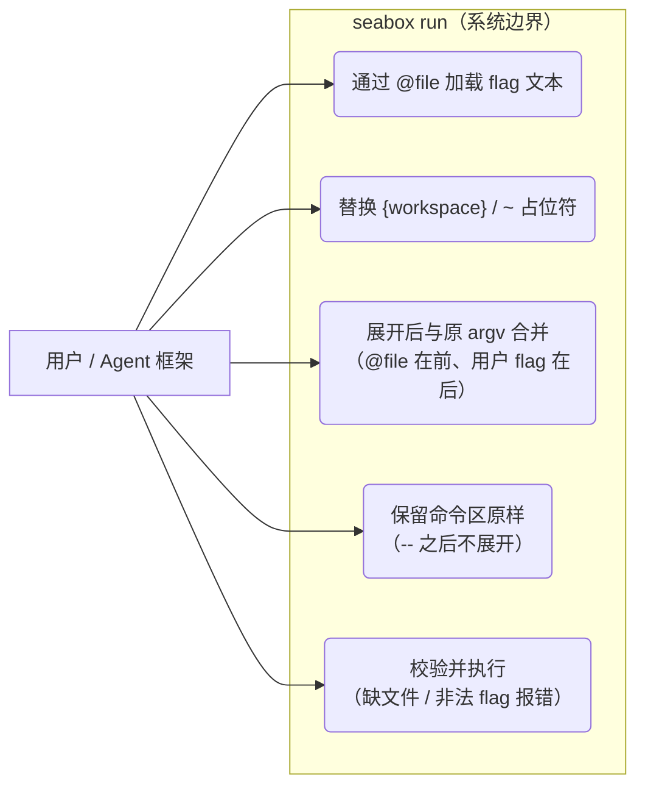
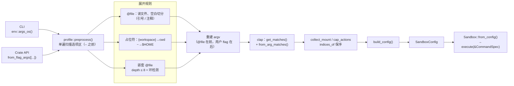

# coding-agent profile — 设计方案

> 设计时间：2026-08-08
> 状态：**提案**
> 前置：`docs/arch/coding-agent-profile/context.md`
> 目标文件：`docs/adr/0005-profile-argfile.md`

---

## 1. 需求回顾（从 context.md 提炼）

profile = 一段 CLI flag 文本序列（argfile 模式），**不设计配置内容结构**。

- CLI：`seabox run @profile.txt -- cargo build`
- Crate API：`SandboxConfig::from_flag_args([...])`
- 展开进 argv 后走**同一个 clap 解析器**，顺序/合并/校验全复用
- 占位符：`{workspace}` → cwd、`~` → `$HOME`
- 追加语义：profile 在前、用户 flag 在后
- **不提供内置命名预设**（2026-08-11 决策）：flag 内容完全由使用方通过 `@file` 提供，
  seabox 只做展开机制，机制与内容解耦

**图 2：用例（Use Case）**



### 2.1 使用流程（Use Case 场景）

| 场景 | 动作 | 期望结果 |
|------|------|---------|
| 用户手动用文件 | `seabox run @dev.profile -- cargo build` | flag 展开进 argv，`cargo build` 在沙箱内执行 |
| 用户覆盖 | `@dev.profile` 内 `--unshare-net`，命令再加 `--share-net` | 用户 flag 在后，覆盖 profile 的网络预设 |
| 命令区保护 | `-- echo '@foo'` | `@foo` 不被误当 profile 文件展开 |
| 错误处理 | `@missing.txt` | 报错退出，不进入沙箱 |

## 2. 调研摘要

| 发现 | 结论 |
|------|------|
| clap 无内置 argfile 支持（[issue #1693](https://github.com/clap-rs/clap/issues/1693)），官方文档推荐「解析前预处理」 | 我们自写预处理，不引新依赖 |
| [argfile crate](https://docs.rs/argfile/) 做 `@file` 展开 | 调研后弃用：需支持 `{workspace}` 占位符 + 避免引新依赖 |
| GCC/rustc `@file` response-file 惯例 | 采纳：`@` 前缀 + 空白切分 + 引号/注释处理 |
| bubblewrap 无 profile 概念 | 机制对齐 bwrap 的「CLI flags 唯一输入源」 |

## 3. 候选方案对比

三份候选由三个独立 agent 生成，分别代表**最小复杂度**（A）、**可扩展优先**（B）、**性能/资源优先**（C）。

### 3.1 对比矩阵

| 维度 | 方案 A：最小复杂度 | 方案 B：可扩展优先 | 方案 C：性能优先 |
|------|:---:|:---:|:---:|
| **核心抽象** | 1 个预处理 fn（`preprocess`） | 4 个新类型（`ProfileRegistry`/`ArgSource`/`ArgExpander`/`PlaceholderResolver`） | 单遍扫描 fn |
| **展开时机** | 预扫描 argv → 展开 → 重建 → 单次 clap | 预扫描 → 展开（递归嵌套 depth≤8 + 环检测）→ 原位替换 → 单次 clap | 单遍扫描 → 剥离 `@` → 单次 clap |
| **嵌套 profile** | 不支持 | 支持（depth≤8 + 环检测） | 支持（设深度上限） |
| **占位符替换** | `Cow<str>`，仅 profile 来源 token | trait `PlaceholderResolver`，可注册新占位符 | `Cow<str>` 零分配（无占位符时 Borrowed） |
| **scalar 覆盖** | `.args_override_self(true)` 处理 `--uid`/`--timeout` 等 | 未明确 | 未明确 |
| **CLI→config 管线下沉** | 可选（cli.rs 迁移） | 必须（`src/args.rs`） | 必须（`config_from_parsed`） |
| **代码量** | ~130 行 | 更多（4 类型） | ~100 行 |
| **新依赖** | 0 | 0 | 0 |

### 3.2 共识（三方案一致）

1. 展开发生在 clap 解析**之前**（预扫描），`--` 之后命令区不展开
2. 占位符 `{workspace}`/`~` 复用已有 `expand_tilde`（`src/config.rs`）
3. CLI→config 管线（`build_config` + `collect_mount/cap_actions`）下沉进库，`from_flag_args` 复用同一 clap 解析器——clap 已是主依赖
4. 不引入 serde（保持 dev-dependency）
5. 测试放 `tests/profile_test.rs`，探针式跳过

### 3.3 推荐：A + C 骨架，采纳 B 的嵌套环检测

- **采纳 A 的 scalar 覆盖**：`.args_override_self(true)` 处理 `--uid`/`--chdir`/`--timeout` 等单值 flag 在 profile 与用户同时出现时的合并
- **采纳 B 的嵌套环检测**：`@file` 内可再 `@other`，设深度上限（如 8）+ 环检测，防递归爆栈
- **否决 B 的 4 类型抽象**：registry + 2 trait + ArgSource 对"不做内容结构设计"的约束过重；来源只有 1 种（`@file`），不需要 trait 化
- **否决内置命名预设**（方案 C 的 static 表 / 方案 A 的 enum variant）：需求方明确"不提供预设"，flag 内容完全由使用方 `@file` 提供，机制与内容解耦

## 4. 最终方案

### 4.1 模块划分

```
src/profile.rs   （新增，lib）预处理：@file 展开 + 占位符替换
src/config.rs    新增 SandboxConfig::from_flag_args()（复用 cli 解析管线）
src/lib.rs       导出 pub mod profile;
src/main.rs      调用 profile::preprocess 后进 clap（原有两步法不变）
tests/profile_test.rs   （新增）集成测试
```

> **落地分两步**（review 建议，回归风险最小）：
> 1. **Step 1 CLI-only**：新增 `src/profile.rs`，main.rs 在 clap 前调 `preprocess` 拼 argv。
>    不动现有 `build_config`/`collect_*` 管线，可独立合入。
> 2. **Step 2 管线下沉**：`build_config`/`collect_mount_actions`/`collect_cap_actions`
>    从 main.rs 移入 lib，加 `SandboxConfig::from_flag_args`。此时才动现有代码。

### 4.2 关键数据流

```
CLI:  env::args_os()
  → profile::preprocess()：单遍扫描选项区
        @file        → 读文件，空白切分（支持引号/反斜杠转义/注释），展开
        占位符替换：{workspace}→cwd、~→$HOME（仅 @file 来源 token）
        嵌套：@file 内可再 @other，depth≤8 + 环检测
  → 重建 argv → Cli::command().get_matches() + from_arg_matches（原有两步法）
  → collect_mount_actions（indices_of 保序，@file 在前、用户在后天然有序）
  → build_config → SandboxConfig → Sandbox

Crate API: SandboxConfig::from_flag_args([...])
  → 合成 argv = ["seabox", "run", ...args, "--", "true"]
  → 走同一条 profile::preprocess + clap 解析 + build_config 管线
```

**图 1：数据流（Data Flow）**



### 4.3 核心接口

```rust
// src/profile.rs
/// 预处理 argv：展开 @file，替换占位符。
/// 仅处理选项区（首个裸 `--` 之前）。
pub fn preprocess(
    argv: impl IntoIterator<Item = impl AsRef<OsStr>>,
    cwd: &Path,
    home: Option<&Path>,
) -> anyhow::Result<Vec<OsString>>;

// src/config.rs
impl SandboxConfig {
    /// 从 CLI flag 文本序列构建配置（crate API 镜像，与 CLI 走同一解析管线）。
    pub fn from_flag_args<I, S>(args: I) -> anyhow::Result<Self>
    where I: IntoIterator<Item = S>, S: AsRef<str>;
}
```

### 4.4 展开规则

- **作用域**：只展开选项区——首个裸 `--` 之前；`--` 之后命令区 `@x` 原样（不误展开）。
  注意：command 参数是 `trailing_var_arg + allow_hyphen_values`，**无 `--` 时选项区的
  `@` 也展开**（如 `seabox run @p.txt cargo build`）。此语义用测试固化。
- **合并**：`@file` 展开的 flag 插在原位置（argv 顺序），用户 flag 在后的覆盖语义由现有 CLI 逻辑（`indices_of` 保序 + 重复 flag 追加 + `.args_override_self(true)` 单值覆盖）决定
- **占位符**：对 **`@file` 来源的所有 token**（含 `--bind`/`--ro-bind`/`--tmpfs` 的 SRC/DST）替换 `{workspace}`/`~`；手动 flag 原样（用户自写实际路径）。
  `{workspace}` 语义 = **主进程 cwd**（与 `~`→`$HOME` 对称），非 profile 文件所在目录。
  > **为什么要对所有 token 替换**（review 核实）：运行时 `expand_tilde` 只兜底 landlock path（`landlock.rs:162`）和 cwd（`mod.rs:135`），**mount 路径不展开**（`mount.rs` 用原始字符串）。若 profile 里 `{workspace}`/`~` 作 bind 源路径且不在此处替换，绑定会拿到字面量失败。profile 替换后为绝对路径，运行时二次展开是 no-op，无害。
- **`@` 边界**：`@file` 的 `@` 是 profile 约定前缀；`--` 后命令里的 `@` 不受影响；选项区某 flag 值恰以 `@` 开头会误判为 file（罕见，文档标注，R3）
- **错误**：`@file` 不存在 / 非 UTF-8 → 报错退出（`anyhow`），错误信息含文件名

### 4.5 测试策略（`tests/profile_test.rs`）

| 测试 | 验证 | 内核依赖 |
|------|------|---------|
| 展开顺序 + 合并 | `@file` `--unshare-net` + 用户 `--share-net` → 后者生效 | 无（纯解析） |
| `@` 与 `--` 边界 | 命令区 `@x` 不误展开 | 无 |
| 占位符 | `{workspace}` → cwd、`~` → $HOME | 无 |
| 引号/注释 | 带引号 token 正确切分 | 无 |
| 嵌套环检测 | `@a` → `@b` → `@a` 报环错误 | 无 |
| 错误路径 | 缺文件报错 | 无 |
| 端到端 | `run @profile.txt -- true` 实际执行 | Linux（探针跳过） |
| CLI↔crate 一致性 | `from_flag_args` 与 CLI 等价 | 无 |

profile 测试**不碰工程文件**（tempfile 写 /tmp），符合测试安全约定。

## 5. 风险与未决点

- **R1 单值 flag 覆盖语义**：`.args_override_self(true)` 让后者覆盖，但需确认现有 `--uid`/`--chdir`/`--timeout`/`--hostname` 均适用；`--env` 是 map 语义（追加），不受影响
- **R2 管线下沉重构**（Step 2）：`build_config`/`collect_mount_actions`/`collect_cap_actions` 从 main.rs 移入 lib，是唯一动现有代码的点；需保证 CLI 行为零变化（现有测试兜底）。Step 1 CLI-only 不触碰
- **R3 `@` 前缀歧义**：选项区某 flag 的值恰好以 `@` 开头会误判为 file（罕见，文档标注即可）
- **R4 占位符替换域**：仅 `@file` 来源 token（含 mount SRC/DST）；手动 flag 原样。运行时 `expand_tilde` 不兜底 mount 路径，见 §4.4 说明
- **R5 `--` 边界语义**：`trailing_var_arg` 下无 `--` 时选项区 `@` 也展开——测试固化，见 §4.4

## 6. 后续建议

1. 按 `docs/arch/phase2-wrapup/` 惯例写 ADR（`docs/adr/0005-profile-argfile.md`，已完成）
2. **实现分两步**：Step 1 `profile.rs` CLI-only（拼 argv，不动管线）→ Step 2 管线下沉 + `from_flag_args` → `tests/profile_test.rs`
3. 内容由使用方通过 `@file` 提供，seabox **不内置任何预设**
4. 质量分析见 `docs/arch/coding-agent-profile/review.md`
